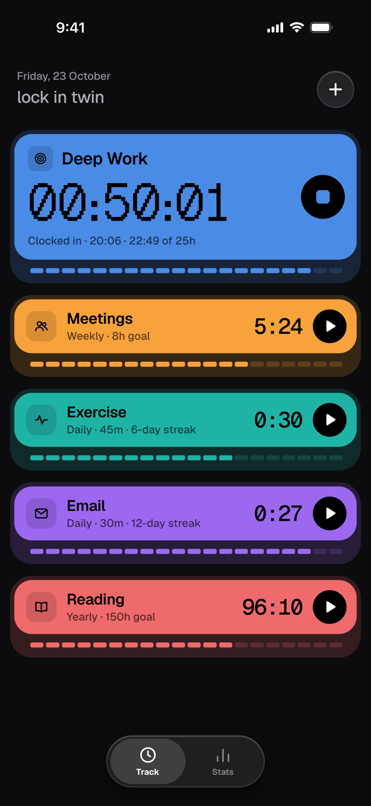
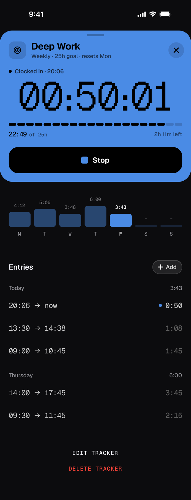
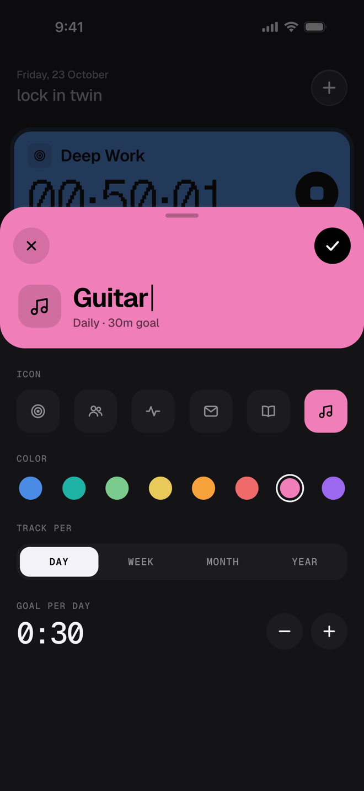
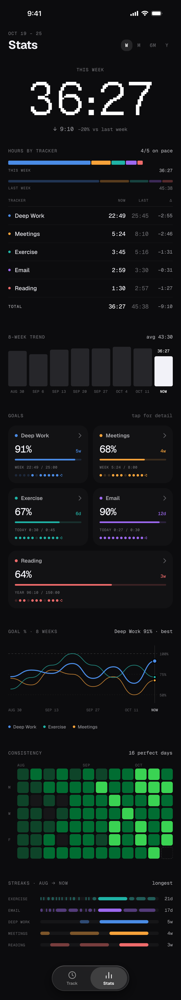
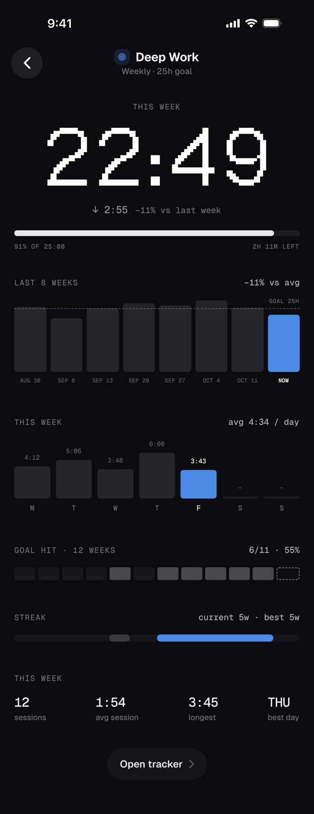
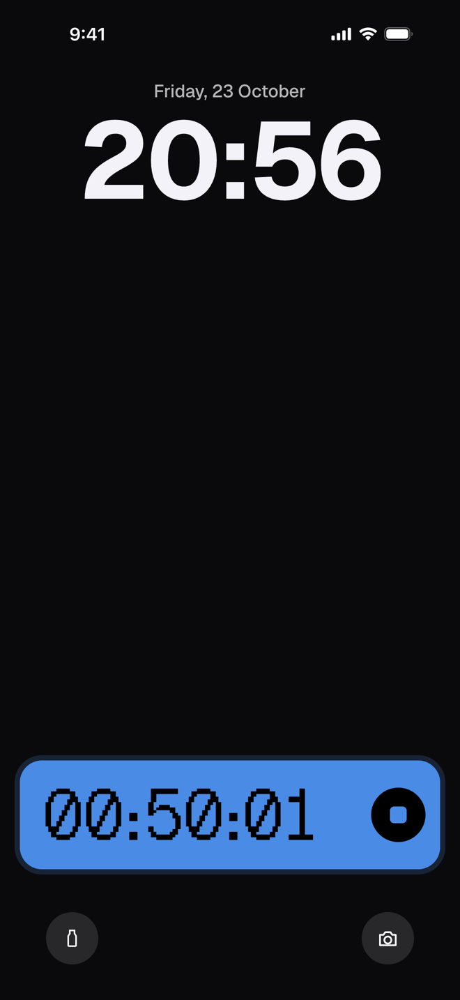
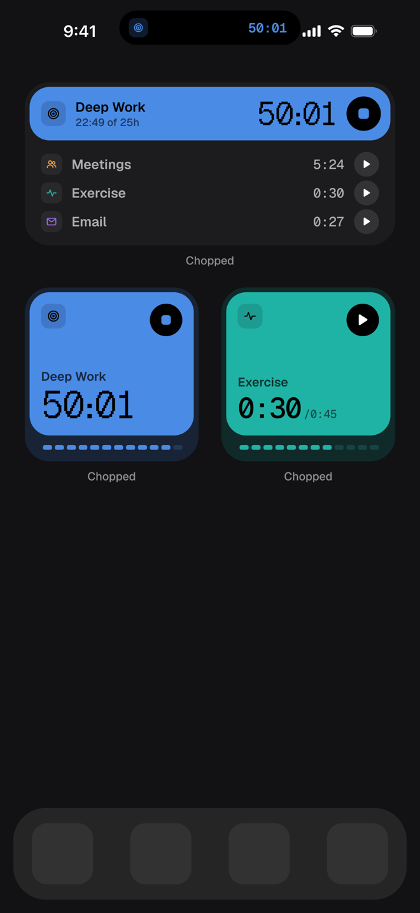
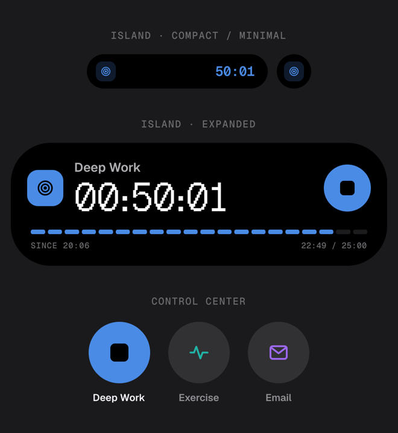

# Chopped: Time Tracker

A minimal iOS time tracker. Clock in to what matters, see where the week went, and keep your streaks alive from the Lock Screen, the Dynamic Island and home-screen widgets.

> The Xcode project and targets still use the original name **Pocus**. The app ships as **Chopped**.

<p align="center">
  
  
  
</p>

## Features

- **One-tap tracking.** Every tracker is a bright card with a live Geist Pixel timer and a 20-tick progress strip toward its goal.
- **Goals per day, week, month or year**, with streaks and a daily rotating pep line on Home.
- **Tracker detail sheet.** Big stop button, this week's day bars, an editable entry list, and edit/delete.
- **Stats.** Weekly hero total, hours by tracker vs last week, 8-week trend, goal cards, goal % chart, a consistency heatmap and streak lanes. Each tracker also has its own stats page.
- **Lock Screen Live Activity and Dynamic Island** with a live timer and a stop button.
- **Interactive widgets.** Small and medium home-screen widgets with play/stop buttons, plus Control Center controls on iOS 18+.
- **Haptics** on start and stop, subtle spring animations, and Reduce Motion support.
- **Local only.** All data lives in SQLite on your phone, shared with the widgets through an App Group. There's no account, no tracking and no network calls.

## Design

Every screen was designed in [Paper](https://paper.design) and built to match it, then checked against the design on an iPhone.

| Stats | Tracker stats |
|---|---|
|  |  |

| Lock Screen | Widgets | Dynamic Island & Controls |
|---|---|---|
|  |  |  |

The type is **Geist** for UI text, **Geist Mono** for numbers, and **Geist Pixel** for the live timer and hero totals. Each tracker has a flat accent color on a near-black (`#0C0C0E`) background.

The shipped app uses the standard iOS Liquid Glass tab bar instead of the custom floating bar shown in these mockups.

## Project layout

| Path | What |
|---|---|
| `Pocus/` | App: entry point, router, `Store` (SQLite), screens in `Pocus/Screens/`, QC harness in `Pocus/QC/` |
| `PocusWidgets/` | Widget extension: home-screen widgets, Live Activity / Dynamic Island, Control Center controls |
| `Shared/` | Code shared by both targets: design system, fonts, App Group data access, App Intents, widget/activity views |
| `design/` | Build spec (`SPEC.md`), API reference (`FOUNDATION.md`), reference renders, design and demo-data generators |
| `docs/screenshots/` | Images used in this README |

## Building

Requirements: Xcode 27, iOS 17+ (Control Center controls need iOS 18+).

```sh
open Pocus.xcodeproj
```

Select the **Pocus** scheme and run it on a device or simulator. Device builds need a signing team that has the App Group `group.com.jackson.Pocus`.

### Design QC mode

Launch arguments render any screen with deterministic demo data that matches the designs, and save a snapshot:

```sh
xcrun simctl launch <sim> com.jackson.Pocus -QCDemo -QCScreen home -QCSnapshot
# screens: home | detail | newTracker | stats | trackerStats | widgets | liveActivity | island
# add -QCFullPage for full scroll height
```

The snapshot is written to the app's `Documents/qc-<screen>.png`. See `design/FOUNDATION.md` for the full harness.

## Fonts

[Geist, Geist Mono and Geist Pixel](https://vercel.com/font) by Vercel, licensed under the SIL Open Font License 1.1.
